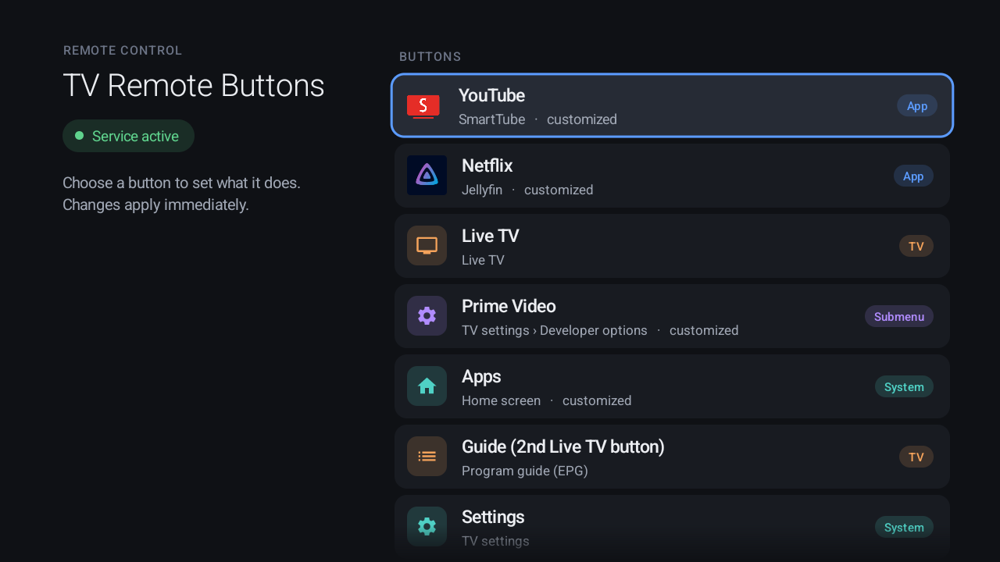

# TV Remote Buttons

Give the buttons of your Android TV / Google TV remote new functions: open any app or a specific
page inside an app, jump to a TV settings submenu, show the program guide, or trigger Home Assistant.
Each button can have separate actions for a single press, pressing twice and holding.



The app is small (about 7 MB RAM), needs no Gradle and no libraries, and is built for D-pad
navigation. Its UI is available in English and German.

## Features

- **Remap app buttons** such as YouTube, Netflix, Prime Video, Live TV, Guide, Apps or Settings,
  and any other button you teach it.
- **Targets**
  - any installed app
  - a specific page of an app, such as a TV settings submenu (Network, Picture, Sound, Timer, …)
  - the live TV app and its program guide
  - the home screen
  - any intent or deep link (`intent:#Intent;…;end`, `market://…`, …)
  - Home Assistant webhooks or any other HTTP endpoint
  - *do nothing*, or keep the factory behavior
- **Press, press twice, hold.** Off by default so every button reacts instantly; switch them on
  under *Press options*. Only buttons that actually have a double-press assignment wait for a
  second press.
- **Device profiles from this repository.** On first start the app detects the TV and its remote and
  recommends a matching profile that already knows the buttons. Profiles are downloaded from
  [`profiles/devices.json`](profiles/devices.json) at startup, so new TVs and remotes need no new
  app version. Remotes and TVs have separate profiles, so a known remote also works on other TVs.
  See **[supported devices](DEVICES.md)**.
- **Teaching buttons.** Press the button, then pick its type (Live TV, Netflix, YouTube, Settings,
  Input, …). The type sets the name and suggests a target.
- **Upload buttons.** Press the special buttons of your remote in any order and pick what is printed
  on each, then send the mapping (TV model, remote, keycodes, types) without an account. Each report
  becomes a public issue, and an agent turns it into a pull request for the profiles. Apps and
  assignments are never sent. One report per TV and day.
- **In-app updates** from the GitHub releases (Android asks you to confirm the installation).
- **Configuration via adb** for setup scripts (see below).

## How it works

An `AccessibilityService` with `flagRequestFilterKeyEvents` sees key presses before the system hands
them to their factory targets. Assigned buttons are consumed and their target is run; every other key
passes through untouched. Home, Back, Power, volume and D-pad keys are never intercepted.

The service only receives key events and window-change events (to know which app is in front, needed
for the program guide). It cannot read screen content.

## Build

Requirements: Android SDK with `platforms/android-34` and `build-tools/34.0.0`, a JDK (11 or newer)
and `rsvg-convert` (librsvg).

```sh
./build.sh            # -> build/tv-remote-buttons.apk
```

`ANDROID_HOME` defaults to `~/Android/Sdk`.

### Signing

Releases are built and signed by GitHub Actions with the release key from the repository secrets
(`SIGNING_KEYSTORE_B64`, `SIGNING_KEY_ALIAS`, `SIGNING_KEYSTORE_PASS`).

Local builds create a key in `~/.android/tv-remote-buttons.jks` on the first run. To sign with an
existing key, create a git-ignored `signing.env` next to `build.sh`:

```sh
KEYSTORE=$HOME/.android/my.jks
KEY_ALIAS=mykey
KEYSTORE_PASS=secret
```

Keep using the same key: Android only installs an update if it is signed with the key of the
installed app. Builds with another key cannot update an installed release.

### Releases and CI

- [`ci.yml`](.github/workflows/ci.yml) checks the profiles and the worker and builds the APK on
  every push and pull request.
- [`release.yml`](.github/workflows/release.yml) builds, signs and publishes a release for every
  `v*` tag. To release, raise `android:versionCode` and `android:versionName` in
  `AndroidManifest.xml`, commit, then run:

  ```sh
  ./release.sh ["release notes"]   # pushes the tag v<versionName>; Actions does the rest
  ```

- [`report-agent.yml`](.github/workflows/report-agent.yml) reviews device reports with Claude and
  proposes profile pull requests (see below).

## Install and enable

```sh
adb install -r build/tv-remote-buttons.apk
```

Open **TV Remote Buttons** from the app list. If the service is not running yet, the app offers
**Turn on service**, which opens *Settings › Accessibility*. You can also enable it via adb:

```sh
adb shell settings put secure enabled_accessibility_services de.diesteinhose.tvremotebuttons/.KeyService
adb shell settings put secure accessibility_enabled 1
```

The first command replaces the list of enabled accessibility services. If others are enabled, append
this one with a `:` separator instead.

## Using the settings screen

- **Overview:** all known buttons with their current target. Select one to change it.
- **Assignment:** the categories on the left are General, Television, Settings, Apps, App submenus,
  Home Assistant, Intent / Link and Button. The matching targets appear on the right. With press
  options switched on, tabs at the top choose between *Press*, *Press twice* and *Hold*.
- **Add button:** press the new button on the remote, then pick its type.
- **Press options:** switch *press twice* and *hold* on or off and choose their timing
  (250/350/500 ms and 400/500/800/1000 ms).
- **Remote & TV:** shows the detected remote and TV. *Identify remote* recognizes the remote from
  one press of an app button (by the input device it comes from); a list and the TV choice are
  there for the rare cases detection is wrong. *Update profiles* loads the latest profiles from
  GitHub right away. Your own assignments are kept.
- **Upload buttons:** map the buttons in a wizard, see exactly what would be sent, add an optional
  note and create a device report.
- **App:** shows the version and installs updates from the latest GitHub release. The first update
  needs *Install unknown apps* to be allowed for the app.

Note: an app cannot hand an intercepted key back to the system. If a button has a *press twice* or
*hold* assignment, its single press can therefore no longer trigger the factory function. Give the
single press a target of its own.

## Device profiles

Profiles live in [`profiles/devices.json`](profiles/devices.json) and come in two layers, which the
app combines:

- **Remote profiles** (`remotes`) - the core: the buttons of a remote with `key` (Android keycode
  name without `KEYCODE_`, or the number of a vendor key), `type` (see
  [`ButtonTypes.java`](src/de/diesteinhose/tvremotebuttons/ButtonTypes.java)), `default` target and
  an optional localized `name`; keys that must never be intercepted (`protect`); and how the remote
  is recognized: `match.inputs` (input device name prefix, vendor and product ID), optionally
  limited to some TV profiles (`match.tvs`) when the TV software maps its buttons differently.
- **TV profiles** (`tvs`): recognized by `brand` and `hardware` prefix; the live TV activity
  (`liveTv`), whether the program guide can be opened (`epg`), TV-level `protect` keys and the
  remotes seen on this TV (`remotes`).

So a remote keeps its buttons on another TV, and a TV keeps its live TV app with another remote.
On first start the app shows the detected remote and TV. The remote can also be identified by
pressing one of its app buttons; the TV rarely needs to be changed. Every entry may have `minApp`, the lowest app versionCode that understands it.

The app loads the profiles from GitHub at startup (at most once per hour, or right away with
*Update profiles*), keeps the last download and falls back to the copy bundled in the APK.
[`profiles/profiles.json`](profiles/profiles.json) (schema 1) is generated from `devices.json` for
app versions up to 1.6; do not edit it.

Check changes with `python3 .github/scripts/check_profiles.py` (`--fix` applies the canonical
formatting and regenerates `profiles.json`); CI runs the same check.

The supported remotes and TVs, their buttons and quirks are listed in
**[DEVICES.md](DEVICES.md)**; every profile needs a section there (the check enforces it).

The easiest way to add a TV is **Upload buttons** in the app: the report becomes an issue, the
report agent opens a pull request that extends `devices.json` and `DEVICES.md`, and after review
and merge every app picks it up on its next start. Manual edits and pull requests are welcome too; to see keycodes:

```sh
adb shell setprop log.tag.RemoteButtons DEBUG
adb logcat -s RemoteButtons
```

## Device reports (upload)

Before uploading, a wizard records the special buttons: press any button of the remote, in any
order, and choose what is printed on it (Live TV, Guide, Netflix, YouTube, Prime Video, Disney+,
Google Play, Apps, Settings, Input, Google Assistant, USB/Media, custom or other button). Buttons that only report a
number or a scan code are fine. Mapped buttons can be changed or removed, every change is saved
right away, and buttons the app did not know yet are added to the overview with factory behavior.

**Upload buttons** then posts a JSON report to a small [Cloudflare Worker](worker/), which files it
as a GitHub issue labeled `device-report`. The GitHub token only exists in the worker, so the app
needs no account. The worker checks size and structure, accepts at most 5 requests per minute and
IP address and one report per TV model and IP address per day (it stores only a SHA-256 hash of
both, for 24 hours), and renders all report text as code so it cannot add links or mentions.

The [report agent](.github/workflows/report-agent.yml) then reviews the report with Claude
(instructions: [`.github/agent/profile-agent.md`](.github/agent/profile-agent.md)): it checks the
mapping for plausibility, identifies the remote first and then the TV, extends the matching remote
and TV profiles or creates new ones, updates
[DEVICES.md](DEVICES.md) and opens a pull request with its assessment; if nothing needs to change it
just comments on the issue. Because reports are anonymous input, the agent runs with a read-only
token and no git credentials and may only edit those two files and run the profile check; a second
job validates the result and opens the pull request. The agent needs the repository secret
`CLAUDE_CODE_OAUTH_TOKEN` (`claude setup-token`, Claude Pro/Max) or can be switched to
`ANTHROPIC_API_KEY`; it runs on Claude Haiku.

A report contains:

- device: brand, manufacturer, model, product, hardware, Android version and, where the vendor
  stores it, the model number of the TV (e.g. `65OLED888/12` on Philips; never the device name you
  gave the TV)
- active and detected profile, app version, press options (on/off)
- input devices that send keys (name, vendor and product ID)
- the button mapping: type, keycode, scan code and the remote each button came from
- the buttons known to the app (keycode, type, own name)
- the optional note

It does not contain assignments, installed apps or the Home Assistant address.

To run your own worker:

```sh
cd worker
npx wrangler login
npx wrangler kv namespace create SEEN  # put the printed id into wrangler.toml
npx wrangler secret put GITHUB_TOKEN   # fine-grained token: your repo, Issues read/write
npx wrangler deploy                    # prints https://tv-remote-buttons.<account>.workers.dev
```

Set `REPO` in `worker/wrangler.toml` to your repository and `Report.URL` in
[`Report.java`](src/de/diesteinhose/tvremotebuttons/Report.java) to `<worker URL>/report`, create the label
(`gh label create device-report`) and allow GitHub Actions to create pull requests in the
repository settings.

## Home Assistant

Choose **Home Assistant** as a target. The button then sends a POST to
`<address>/api/webhook/tv_remote_<button>`, with `_double` or `_long` appended for press twice and
hold. The address defaults to `http://homeassistant.local:8123` and can be changed on the overview.

Payload:

```json
{"key": "BUTTON_5", "keycode": 192, "action": "single", "name": "Custom button", "device": "AI PONT"}
```

Example automation trigger:

```yaml
triggers:
  - trigger: webhook
    webhook_id: tv_remote_button_5
    allowed_methods: [POST]
    local_only: true
```

Any other `http(s)://` URL works as a target as well.

## Configuration via adb

The `ConfigReceiver` accepts broadcasts from the shell only (it requires `android.permission.DUMP`).
Every broadcast prints the current configuration.

```sh
R="am broadcast -n de.diesteinhose.tvremotebuttons/.ConfigReceiver"
adb shell $R                                              # show configuration
adb shell $R --es profile auto                            # detected remote and TV profile (or none)
adb shell $R --es remote chiq_tvc0gwbt --es tv chiq_mt58  # set them separately (each also auto or none)
adb shell $R --ei key 247 --es target com.google.android.youtube.tv
adb shell $R --ei key 192 --es action long --es target @ha
adb shell $R --ei key 192 --es target default             # back to the profile default
adb shell $R --ei test 192                                # trigger a button's target
adb shell $R --ez double_on true --ei double_ms 350       # press options
adb shell "$R --ei key 192 --es target 'intent:#Intent;action=android.settings.WIFI_SETTINGS;end'"
```

Add `--ez keep true` to change only what is not configured yet, which is useful in setup scripts.
`--ez export true` returns all settings as base64 JSON, and `--es import <base64>` restores them,
for example before reinstalling the app.

Target notation:

| Target | Meaning |
|---|---|
| `com.example.app` | start an app |
| `com.example.app/com.example.app.SomeActivity` | start a specific activity |
| `intent:#Intent;…;end` | any intent |
| `scheme:…` | deep link (VIEW) |
| `@livetv`, `@epg` | live TV app, program guide |
| `@home` | home screen |
| `@ha`, `http(s)://…` | webhook |
| `@none` | do nothing |
| `@system` | factory behavior |

## Limitations

- Key presses injected with `adb shell input keyevent` bypass accessibility key filtering. Test with
  the real remote, or use `--ei test <keycode>`.
- The program guide shortcut currently works with the MediaTek live TV app (`chiq_mt58` profile).
- Some TVs start the factory function of certain buttons even though the app intercepts them.
  Philips, for example, hands "global keys" such as Prime Video to the launcher on its own. The
  assigned target still runs, but the factory app may open on top of it. While mapping or teaching
  buttons the app returns to the front by itself.
- Buttons that report no keycode (only a scan code) cannot be assigned; the mapping still reports
  them. The same goes for buttons that share a keycode (on Philips the microphone and the TV button
  both send 811): the mapping keeps them apart by scan code, but they can only be assigned together.
